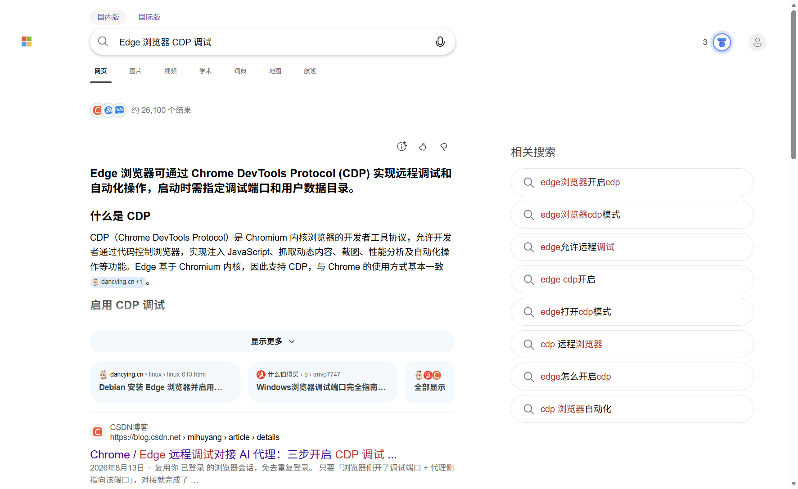

# @local/dsh-edge-browser

A DeepSeek Harness plugin that gives the agent a real browser: it **reads web
pages** and can **operate them** — click, type, scroll, select, run JavaScript
and take screenshots.

简而言之：给 DSH 的 AI 加一双能看网页、也能动网页的手。它通过 Chrome DevTools
协议驱动本机的 **Microsoft Edge**（Chrome 亦可），并使用独立的自动化配置目录，
不碰你日常使用的浏览器窗口、历史记录和登录态。



## Tools

| Tool | Purpose |
| --- | --- |
| `browser_open` | Open a URL in the automation browser; returns title + text preview. |
| `browser_read` | Read a page: cleaned body text, headings, links, optional tables. `readable` keeps main content, `full` returns the whole body. |
| `browser_act` | `click` (selector or visible text), `type` (with `replace` / `submit`), `press`, `scroll`, `select`, `hover`. |
| `browser_eval` | Evaluate a JavaScript expression in the page and return its JSON value. |
| `browser_screenshot` | Capture the viewport or the full page to a PNG file. |
| `browser_wait` | Poll for a selector or a text fragment (visible or gone). |
| `browser_tabs` | Show browser version, profile and every open tab with its id. |
| `browser_close` | Shut the automation browser down. |

All tools share one browser instance. It is launched lazily on the first call
and stays warm between turns; `browser_tabs` shows what is running.

## Behaviour

- **Isolated profile.** Cookies, logins and settings live in
  `%LOCALAPPDATA%\dsh-browser\edge-profile`, not in the user's Edge profile.
  Pages that require an existing login therefore open as a guest.
- **Separate window.** The browser window is normal and visible so the user can
  watch; set `headless: true` to hide it.
- **Debug port.** `127.0.0.1:9333` by default. It is not exposed beyond the
  loopback interface, and the port must stay private: anyone who can reach it
  can control the browser.
- **No dependencies.** A minimal RFC 6455 WebSocket client (`lib/ws.js`) and a
  small CDP session layer (`lib/browser.js`) replace Playwright/Puppeteer, so the
  bundle installs into a profile without a package graph.
- **Network failures are reported plainly.** A host that cannot be reached makes
  Chromium show its error page; the plugin turns that into a single readable
  error instead of a navigation timeout.

## Configuration

Passed through the bundle's `cordis.patch.yml` row; every key is optional.
`%VAR%`, `$VAR` and `${VAR}` references are expanded in the path keys.

```yaml
- insert:
    - id: dsh-edge-browser
      name: '@local/dsh-edge-browser'
      config:
        port: 9333
        browserPath: 'C:\Program Files (x86)\Microsoft\Edge\Application\msedge.exe'
        userDataDir: '%LOCALAPPDATA%\dsh-browser\edge-profile'
        outputDir: '%USERPROFILE%\dsh-browser'
        headless: false
        windowSize: '1440,960'
        navigationTimeoutMs: 15000
        maxChars: 20000
```

| Key | Default | Meaning |
| --- | --- | --- |
| `port` | `9333` | DevTools port on 127.0.0.1. |
| `browserPath` | auto-detect | Edge/Chrome executable. |
| `userDataDir` | `%LOCALAPPDATA%\dsh-browser\edge-profile` | Isolated automation profile. |
| `outputDir` | `%USERPROFILE%\dsh-browser` | Screenshot directory. |
| `headless` | `false` | Run without a visible window. |
| `windowSize` | `1440,960` | Initial window size. |
| `navigationTimeoutMs` | `15000` | Wait for `document.readyState === 'complete'`. |
| `maxChars` | `20000` | Default `browser_read` text cap. |

If Edge is already running a window, the automation instance still starts
separately because it uses its own `userDataDir`. If the plugin reports that the
browser exited immediately, another process is holding that profile or the port.

## Requirements

- DeepSeek Harness desktop (the host provides `tools`; the bundle has no peer
  packages).
- Microsoft Edge or Google Chrome installed locally.

## Install

The normal path is the plugin manager:

```
plugin_manager action: install_bundle target: <path to this directory>
plugin_manager action: set_bundle   target: @local/dsh-edge-browser enabled: true
```

`install_bundle` runs `pnpm` in the DSH profile. In an offline or firewalled
environment that can stall while pnpm re-resolves unrelated dependencies (for
example `github:` specs when github.com is unreachable). The dependency-free
fallback used in this repository's development profile:

1. junction `%USERPROFILE%\.dsh\profiles\desktop\node_modules\@local\dsh-edge-browser`
   pointing at this directory;
2. add `"@local/dsh-edge-browser": "link:<absolute path>"` to the profile's
   `package.json` dependencies;
3. `plugin_manager action: set_bundle target @local/dsh-edge-browser enabled: true`.

Because the dependency is a `link:`, edits take effect after a disable/enable
cycle of the bundle; no reinstall is needed.

## Development

- `index.js` registers the eight tools; `lib/browser.js` is the CDP client and
  the in-page programs (`pageRead`, `pageClickTarget`, …); `lib/ws.js` is the
  WebSocket transport.
- The plugin has no build step and no runtime dependencies. Node's own `fetch`,
  `child_process` and `http` modules are all it needs.
- Validate a change by reloading the bundle (disable → enable) and calling
  `browser_tabs`, then a real `browser_open` / `browser_read` pair.

## Limitations

- **Guest sessions.** The automation profile starts empty, so sites behind a
  login need either an interactive login in that window or a copied profile.
- **Single browser.** One instance per host; concurrent calls are serialised
  through CDP.
- **Not a scraping framework.** No proxy pool, no anti-bot handling, no
  distributed crawling — it is a window the agent can see and touch.

## License

MIT
